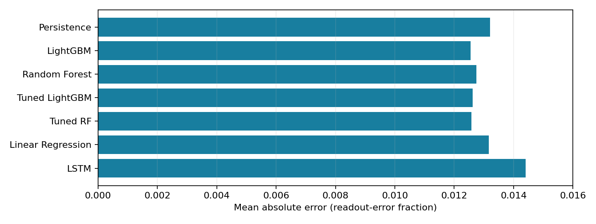

# QubitWatch ML Project

## PBL reports

- [Previous Training PBL report](reports/AIL0303_TrainingPBL_QubitWatch_Report.pdf)
- [Research PBL Part 2: Structured Literature Survey and Research Gap Refinement](reports/QubitWatch_PBL_Part_2_Literature_Survey.pdf)

The Part 2 report is a literature survey and gap-refinement submission, not a final experimental research paper. Its preparation did not verify the original notebook or dataset; its proposed evaluation requirements should be read in that context.

## Included
- `Models_training.ipynb` (original executed notebook)
- `quantum_readout_error_cleaned.csv` (provided cleaned calibration dataset)
- `figures/` (genuine notebook output and a model-comparison chart computed from recorded metrics)

## Original dataset and attribution
Dataset: phanerozoic/qiskit-calibration-drift
https://huggingface.co/datasets/phanerozoic/qiskit-calibration-drift
Source attribution: phanerozoic, qiskit-calibration-drift (CC BY 4.0). The included CSV is the submitted cleaned extract rather than a full copy of the upstream dataset.

## Running the notebook
1. Open `Models_training.ipynb` in Google Colab or Jupyter.
2. Upload the CSV to `/content/quantum_readout_error_cleaned.csv` in Colab, or change the notebook path for your environment.
3. Install missing Python dependencies if needed: `pip install pandas numpy matplotlib seaborn scikit-learn lightgbm torch joblib`.
4. Execute the notebook cells in order. Some cells depend on intermediate model files (`.joblib`) not supplied and those must be recreated before running corresponding loading cells. Full model training can be resource intensive.
5. The notebook contains historic genuine executed results; these are not a guarantee of an immediate fresh run.

## Experimental results
Corrected common chronological test: 88,478 predictions across 601 backend-qubit series. Best MAE: LightGBM (0.012556). Best RMSE (0.038324) and R2 (0.728270): tuned LightGBM. XGBoost shown in the poster was run under a separate, non-comparable protocol.

